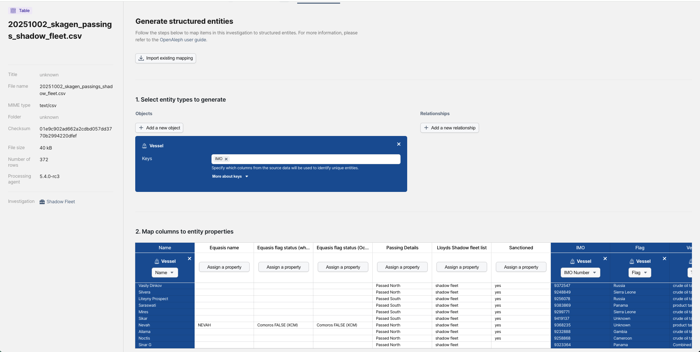
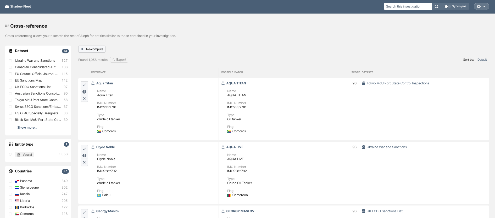
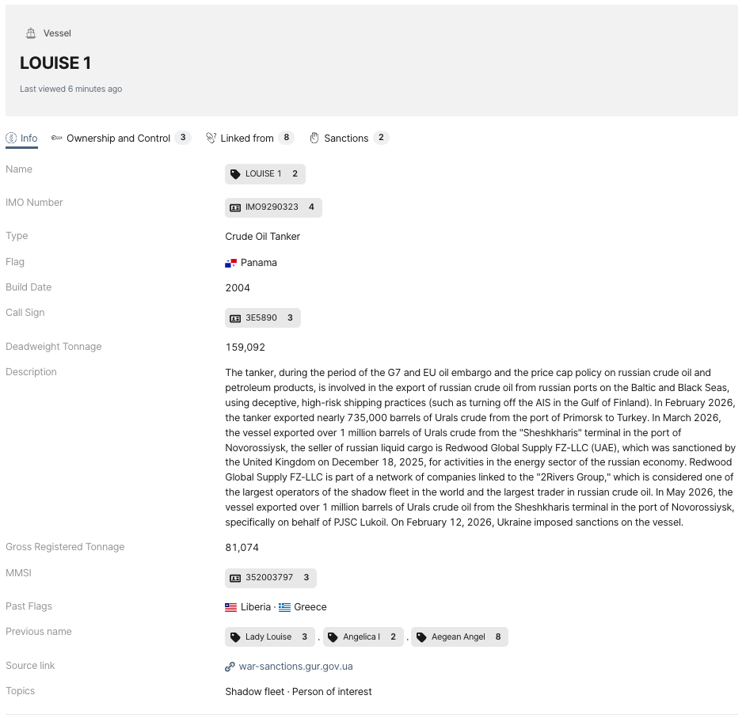
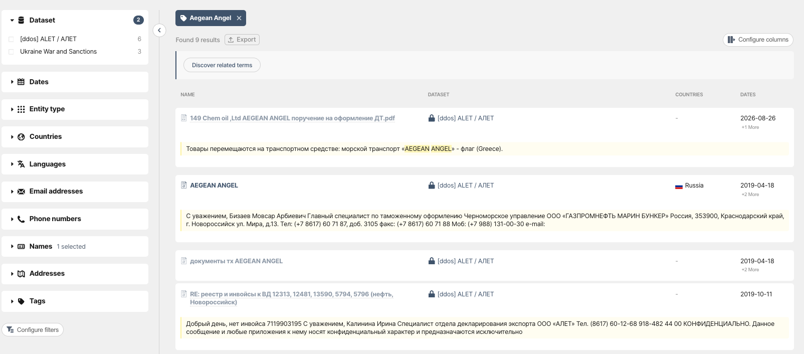

# A Shadow Fleet for a Shadow Researcher

> How to use Cross-reference to find connections between entities and datasets in OpenAleph.

<!-- more -->

Let's imagine you're tracking Russian shadow fleets: the clandestine network of vessels, mostly oil tankers, used to evade sanctions.

You have a list of vessel names and need to fish for leads: Are any already sanctioned? Do they appear in other OpenAleph datasets? And what might their records reveal about past activities and connections?

For this example, we'll use a dataset of shadow fleet vessels entering or leaving the Baltic Sea between June 19 and October 2, 2025\. The list was retrieved from Lloyd's List Intelligence Seasearcher, a maritime tracking service, and is available on [Greenpeace Germany's website](https://daten.greenpeace.de/dataset/shadow-fleet-vessels-passing-skagen-june-19-to-oct-2-2025).

## Let's put a cross on it

One OpenAleph feature that can help is **Cross-reference**.

Cross-reference checks whether entities in your dataset already exist in other data collections and shows you the information available about them.

The process is straightforward:

1. *Upload your dataset*

Upload the CSV file containing the entities you want to investigate.

2. *Map your properties*

Tell OpenAleph which FollowTheMoney properties identify your entities, such as name, IMO, flag, vessel type and build date.

3. *Run Cross-reference*

OpenAleph checks your entities against the available data collections in your instance and returns the matches.

For the 182 vessels in our list, we get 1,058 results, ranked by likelihood of being a true match.

## Following the trail: Louise 1

Take the Ukraine War and Sanctions database, for example (thanks, again [OpenSanctions](https://www.opensanctions.org/)!). It tells us that one oil tanker, the *Louise 1*, was sanctioned by Ukraine in February 2026 for exporting crude oil and petroleum products through the Baltic under a Panamanian flag. It also provides plenty of information about the vessel's owners, activities and the sanctioned companies it carried oil on behalf of.

We also learn about its previous flags and former names. These are exactly the details we need to keep digging and track the vessel's past activities and movements.

But there's more to find under its current name.

## Angel, where will you lead us from here?

Clicking on one of the previous names, “Aegean Angel,” brings up six more matches in the ALET dataset. The data comes from a [2022 leak shared by our friends at DDoSecrets](https://ddosecrets.org/article/alet), containing 1.1 million emails from ALET, a Russian company handling customs declarations on behalf of exporters.

That's where things get interesting.

The emails and documents reveal that in 2016, the same vessel was used to transport oil from Russia to a European trading company, Chemoil Monde. At the time, Chemoil Monde was already owned by the Fratelli Cosulich Group, a conglomerate operating across numerous sectors, including supply.

A simple vessel list has now led us from sanctions records to a leaked email archive and further trading connections.

Was this a one-off shipment, or part of a longer trading relationship? Which other European companies received oil from the vessel? Did its trading partners change after Russia's full-scale invasion of Ukraine? And were there other vessels involved in similar shipments?

These are the kinds of leads that can turn a vessel list into a much bigger investigation.

There's another feature we can use for similar scenarios, this time working with full text rather than structured entities. More on that in the next post\!

**Want to try it yourself?**

Play around with our public OpenAleph instance [here](https://search.openaleph.org/).

Journalists, NGOs and newsrooms interested in accessing the full range of OpenAleph features and datasets can [get in touch with us](mailto:hi@dataresearchcenter.org). Organizations can also set up their own OpenAleph instance and [contact us](mailto:hi@dataresearchcenter.org) to discuss managed hosting and support.